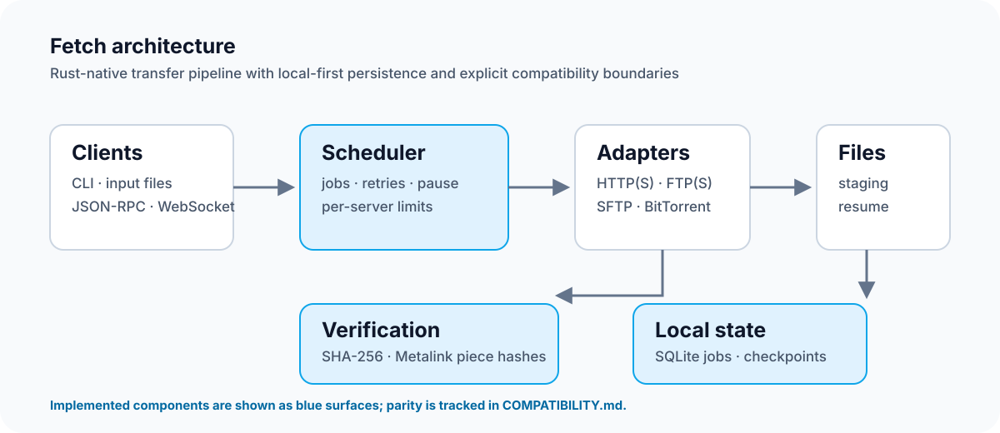

.. image:: https://github.com/theworker02/fetch/actions/workflows/fetch-rust.yml/badge.svg?branch=master
   :target: https://github.com/theworker02/fetch/actions/workflows/fetch-rust.yml
   :alt: Fetch Rust CI

.. image:: https://img.shields.io/badge/language-Rust-dea584?logo=rust&logoColor=white
   :alt: Rust

.. image:: https://img.shields.io/badge/license-GPL--2.0--only-334155
   :target: COPYING
   :alt: GPL-2.0-only

.. image:: https://img.shields.io/badge/origin-aria2%20fork-4f46e5
   :target: https://github.com/aria2/aria2
   :alt: aria2 fork

Fetch
=====

Fetch is a Rust-native, local-first multi-source download engine and a
GPL-2.0-only fork of `aria2 <https://github.com/aria2/aria2>`_. The fork
retains aria2 history, source tree, release references, and its upstream remote
while a clean-room Rust implementation is built subsystem by subsystem.

This repository is an active migration, not a claim of full aria2 parity.
Implemented behavior is documented precisely in `COMPATIBILITY.md
<COMPATIBILITY.md>`_.

What works today
----------------

* Multi-source, segmented HTTP/HTTPS downloads with atomic staging, SHA-256,
  resumed range checkpoints, proxy routing, typed timeouts, and per-server
  concurrency limits.
* FTP, FTPS, and password-authenticated SFTP downloads via libcurl. FTPS keeps
  certificate validation enabled.
* Metalink v4 source extraction and full-file/per-piece SHA-256, SHA-1, and
  MD5 verification for an explicit file entry.
* BitTorrent and magnet downloads through the Rust-native ``librqbit`` adapter.
* A loopback-only JSON-RPC daemon with token authentication, SQLite job state,
  retry, pause/unpause, safe restart requeueing, and WebSocket events.
* aria2-style multi-job input files: one job per URI line, space-separated
  mirrors, and an indented relative ``out=FILE`` destination.

Quick start
-----------

Requires a current Rust toolchain.

.. code-block:: powershell

   cargo run -p fetch -- get https://example.com/file.bin --output file.bin --splits 8
   cargo run -p fetch -- get --input-file .\downloads.txt
   cargo run -p fetch -- daemon --rpc-secret $env:FETCH_RPC_SECRET

``downloads.txt`` may contain independent jobs and mirror sets:

.. code-block:: text

   https://mirror-a.example/file.iso https://mirror-b.example/file.iso
     out=file.iso
   https://example.invalid/release-notes.txt
     out=release-notes.txt

Project map
-----------

``crates/fetch``
  Rust CLI, downloader, verifier, BitTorrent adapter, daemon, and typed config.

``assets/``
  Original Fetch SVG brand assets.

``docs/images/``
  Architecture diagrams and documentation visuals maintained with the code.

``doc/`` and historical source directories
  The retained upstream aria2 implementation and documentation, used as the
  migration baseline until a Rust subsystem replaces it.

``MIGRATION.md`` and ``COMPATIBILITY.md``
  The parity contract, current supported subset, and explicit non-goals.

Security model
--------------

Fetch does not silently inherit proxy behavior, disable certificate validation,
or expose its daemon remotely. The daemon binds to ``127.0.0.1`` by default;
remote use requires an intentionally deployed authenticated TLS proxy. Runtime
RPC secrets are never persisted. URI credentials are redacted before durable
job state is written.

Migration status
----------------

The original C++ tree remains part of this actual fork while the replacement is
completed. Important work still in progress includes XML-RPC, cookie and
``.netrc`` compatibility, bandwidth controls, expanded protocol fixtures,
full BitTorrent behavior, and the broader aria2 option catalogue. Fetch rejects
unsupported configuration options instead of silently accepting them.

Contributing and license
------------------------

Please review `FETCH.md <FETCH.md>`_ for usage and security details before
contributing. Fetch inherits aria2's GPL-2.0-only license and attribution; see
``COPYING`` and ``AUTHORS``.
